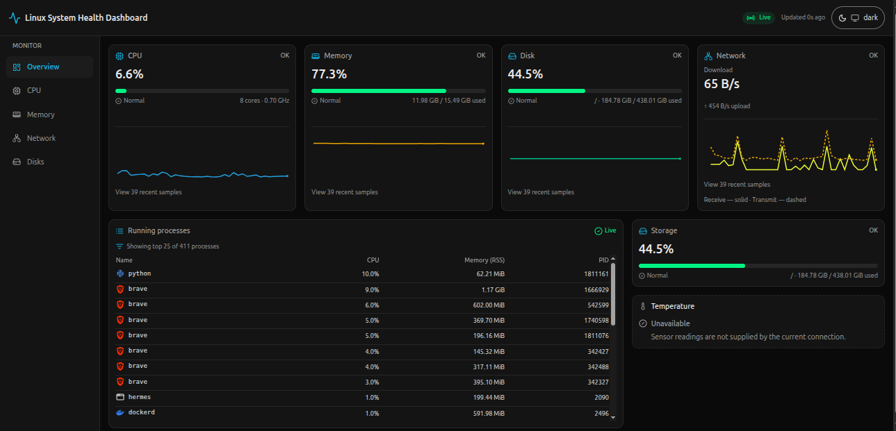
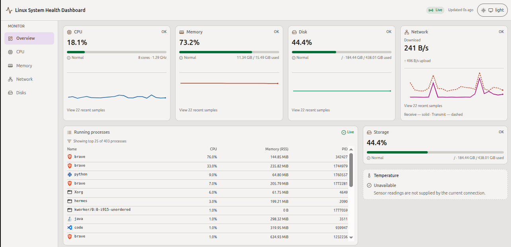
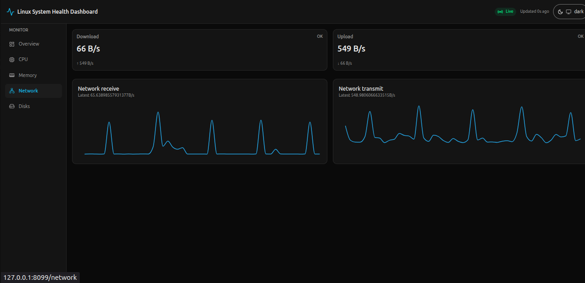
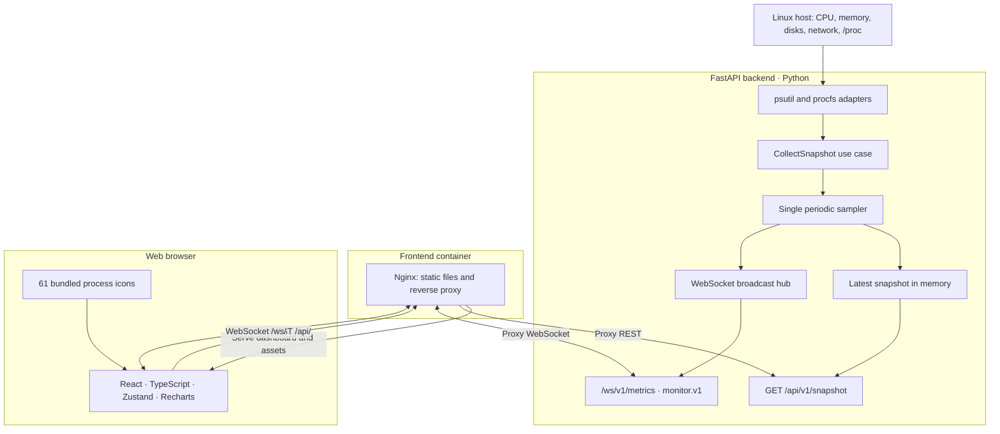

# Linux System Health Dashboard

**Real-time, read-only Linux host monitoring with FastAPI, React, WebSockets, and Docker.**

Monitor CPU, memory, storage, network activity, and running processes from a responsive dashboard with live charts, light/dark themes, and recognizable application icons. A single backend sampler collects system snapshots and publishes them to the browser approximately once per second.



> **Status:** Working end-to-end in Docker. Live browser verification confirmed correct process icons, streaming updates, and no console or failed-network requests in the tested session. This is a local monitoring tool, not a hosted multi-user observability service.

## Highlights

- **Live monitoring:** CPU utilization, core count and frequency; memory and swap; disk usage; network receive/transmit rates; and top running processes.
- **Real-time delivery:** WebSocket snapshots using a versioned protocol, with a REST endpoint for the latest snapshot.
- **Process visibility:** PID, name, CPU percentage, and resident memory (RSS), ordered by CPU on the server; up to 25 rows displayed by default.
- **61 application icons:** Local assets with exact-name matching for 130 process aliases, plus a neutral icon for unknown processes. No runtime third-party icon service.
- **History charts:** Recent samples for CPU, memory, disk, and network, with responsive layouts.
- **Honest status handling:** Loading, partial, unavailable, stale, disconnected, and error states instead of misleading zero values.
- **Light and dark themes:** Accessible status labels and theme-aware visualizations.
- **Containerized deployment:** Docker Compose with Nginx serving the frontend and proxying API/WebSocket traffic.
- **Automated validation:** Backend and frontend checks plus Docker image builds in GitHub Actions.

## Screenshots

<details>
<summary><strong>Light theme — full dashboard</strong></summary>



</details>

### Network monitoring



> Screenshots show actual readings from a test Linux host. Values vary with workload and sampling time. Temperature readings are unavailable in the currently tested connection.

## Architecture



**How it works:** The backend reads Linux metrics through `psutil` and procfs adapters. `CollectSnapshot` assembles a snapshot; a single periodic sampler distributes it to an in-memory latest-value cache and WebSocket clients. The React UI receives updates through Nginx, which also serves the compiled frontend and local icon assets. REST requests use the latest available snapshot rather than initiating a separate sampling loop.

**Process namespace:** Docker Compose mounts `/proc` read-only as `/host/proc` for process enumeration. This improves host-process visibility but does **not** make all metrics host-wide or cgroup-aware; see [Limitations](#limitations).

### Code organization

| Layer | Responsibility |
|---|---|
| `backend/src/monitor/domain/` | Domain types, results, and reader interfaces |
| `backend/src/monitor/application/` | Snapshot collection, sampling, and application ports |
| `backend/src/monitor/infrastructure/` | Linux/psutil/procfs readers and system adapters |
| `backend/src/monitor/presentation/` | FastAPI REST endpoints and WebSocket delivery |
| `backend/src/monitor/composition.py` | Dependency wiring |
| `frontend/src/` | React application, domain/application/infrastructure/presentation slices |
| `contracts/ws/v1/` | Shared versioned WebSocket protocol, schemas, and fixtures |

## Technology stack

| Area | Technologies |
|---|---|
| Backend | Python 3.11–3.13, FastAPI, Uvicorn, Pydantic v2, psutil |
| Frontend | React 18, TypeScript 5, Vite 6, Tailwind CSS 3 |
| State and charts | Zustand, Zod, Recharts |
| Live transport | WebSocket; JSON protocol `monitor.v1` |
| Deployment | Docker Compose, Nginx |
| Backend quality | pytest, pytest-asyncio, Hypothesis, Ruff, strict mypy, import-linter |
| Frontend quality | Vitest, Playwright, TypeScript, ESLint |
| CI | GitHub Actions: backend, frontend, Docker build |

## Getting started

### Requirements

- Linux host
- Docker Engine and Docker Compose v2 for the simplest setup
- For development without Docker: Python 3.11+, [`uv`](https://docs.astral.sh/uv/), Node.js 20.19+ or 22.12+, and npm

### Option A — Docker Compose (recommended)

From the repository root:

```bash
./start.sh
```

The supplied Compose configuration binds the dashboard to **http://127.0.0.1:8099** on the host. The backend listens inside the Compose network; Nginx proxies browser REST and WebSocket requests to it.

Alternatively, manage the stack directly:

```bash
docker compose up --build -d
docker compose ps
docker compose logs -f
docker compose down
```

> **Security:** The provided Compose setup is designed for local, trusted use. Do not expose the dashboard or host `/proc` metadata to untrusted networks without adding appropriate access controls.

### Option B — Local development

Start the backend in one terminal:

```bash
cd backend
uv sync
uv run uvicorn monitor.presentation.api.app:create_app --factory --reload --port 8080
```

Start the frontend in another terminal:

```bash
cd frontend
npm install
npm run dev
```

Vite proxies `/api` and `/ws` to `http://127.0.0.1:8080`. Use the local URL printed by Vite to open the dashboard.

## Monitoring features

| Section | What it shows |
|---|---|
| Overview | Live CPU, memory, disk, and network summaries; history; top processes; availability states |
| CPU | Total utilization, core information, and recent CPU history |
| Memory | Utilization, used/total capacity, and recent history |
| Network | Download and upload rates with receive/transmit history |
| Disks | Storage utilization, used/total capacity, and history |
| Running processes | Up to 25 CPU-ranked processes, PID, CPU, RSS, and recognized app icons |

Process rows reflect the **server-provided ordering**; client-side sorting and filtering controls are not part of the current v1 UI. Unknown process names intentionally use a neutral icon.

### Application icons

The process icon registry contains **61 application identities and 130 exact aliases**. Icons are shipped as separate local assets and loaded when rendered; no icon discovery scans the host filesystem and no external icon API is contacted. The registry uses case-normalized exact matching, including selected Linux process-name truncations, to avoid false positives.

Asset provenance, attribution, license conditions, and trademark caveats are documented in [`frontend/src/assets/process-icons/README.md`](frontend/src/assets/process-icons/README.md) and [`frontend/public/THIRD_PARTY_NOTICES.txt`](frontend/public/THIRD_PARTY_NOTICES.txt).

## REST and WebSocket API

### REST

```http
GET /api/v1/snapshot
```

Returns the most recently available system snapshot. The backend also provides a health endpoint used by the Compose healthcheck:

```http
GET /api/v1/healthz
```

### WebSocket

```text
/ws/v1/metrics
Subprotocol: monitor.v1
```

Messages use the versioned envelope:

```json
{
  "v": 1,
  "type": "snapshot",
  "seq": 42,
  "ts": "<ISO-8601 timestamp>",
  "data": {}
}
```

The example illustrates the envelope shape; `data` is abbreviated, not a complete snapshot payload. The protocol defines server messages such as `hello`, `snapshot`, `error`, `ping`, and `bye`, and client messages such as `subscribe`, `ping`, and `pong`.

For authoritative message shapes, validation rules, and close codes, see [`contracts/ws/v1/PROTOCOL.md`](contracts/ws/v1/PROTOCOL.md).

## Configuration

Backend settings use the `MONITOR_` environment-variable prefix. Relevant options include:

| Variable | Purpose |
|---|---|
| `MONITOR_HOST` / `MONITOR_PORT` | Backend bind address and port |
| `MONITOR_ENVIRONMENT` | `development`, `testing`, or `production` |
| `MONITOR_SAMPLE_INTERVAL_SECONDS` | Sampling interval (1–10 seconds) |
| `MONITOR_ALLOWED_ORIGINS` | Browser origin allowlist |
| `MONITOR_PROCESS_PROCFS_PATH` | procfs path used for process enumeration |
| `MONITOR_MAX_WS_CLIENTS` | WebSocket client limit |
| `MONITOR_WS_QUEUE_SIZE` | Per-client outbound queue capacity |
| `MONITOR_LOG_LEVEL` / `MONITOR_LOG_JSON` | Logging configuration |

See [`backend/src/monitor/config/settings.py`](backend/src/monitor/config/settings.py) for the complete supported configuration and validation rules.

By default, the backend binds to `127.0.0.1`; the Compose setup explicitly binds it to `0.0.0.0` **inside the container** so Nginx can reach it. Production configuration requires explicit allowed origins.

## Testing and quality

Run backend checks from `backend/`:

```bash
uv run pytest
uv run ruff check .
uv run ruff format --check .
uv run mypy --strict src
uv run lint-imports
```

Run frontend checks from `frontend/`:

```bash
npm run typecheck
npm run lint
npx vitest run
npm run build
```

For browser E2E testing, run the project's Playwright suite using its configured environment:

```bash
cd frontend
npx playwright test
```

### Latest reported verification

- **Frontend:** 313 Vitest tests passed; typecheck, lint, and production build passed during the 61-icon milestone.
- **Live Docker/Chromium check:** WebSocket updates approximately once per second; tested process icons matched running processes; no browser console errors or failed requests in the observed session.
- **Icon assets:** All 61 bundled application assets decoded in the asset-rendering check; unknown processes retained the neutral fallback.
- **GitHub Actions:** The reported push workflow completed successfully with backend, frontend, and Docker build jobs passing.

These results describe specific verification runs, not a guarantee for every Linux distribution or browser. The full live E2E check did not launch every supported application.

## Security and privacy

- Read-only monitoring endpoints; the dashboard does not manage or terminate processes.
- Localhost binding for the published frontend port in the provided Compose file.
- Configurable allowed origins and WebSocket origin validation.
- No command-line arguments or environment variables collected for the process table.
- Host process metadata can still be sensitive; the read-only `/proc` mount is **not** a confidentiality boundary.
- No built-in user authentication in v1. Deploy only in a trusted environment unless additional authentication and network controls are provided.

## Limitations

- The dashboard is designed primarily for **one trusted Linux host**, not a distributed multi-host monitoring platform.
- CPU/memory values are based on the collector's available host/container view, not a guaranteed cgroup-accounting model.
- Process enumeration may be partial because of permissions, disappearing processes, or procfs visibility; the UI reports partial/unavailable states.
- Recent scalar history is held in memory; there is no persistent time-series database or per-client backlog replay.
- Temperature sensor data is not supplied in the tested deployment, so the UI reports it as unavailable rather than inventing a reading.
- The process table displays the server's top-N ordering; client-side sorting/filtering is not implemented in v1.
- Some bundled application artwork has attribution, trademark, conditional-use, or repository-level licensing caveats; consult the third-party notices before redistribution.

## Repository layout

```text
.
├── backend/                 # FastAPI backend and Linux collectors
├── frontend/                # React UI and bundled process icons
├── contracts/ws/v1/         # Versioned WebSocket schemas and protocol
├── deploy/                  # Dockerfiles and Nginx configuration
├── docs/
│   ├── design-system/
│   └── images/              # README screenshots
├── .github/workflows/       # CI workflows
├── docker-compose.yml
├── Makefile
├── start.sh
└── README.md
```

## License and attribution

A repository-level software license was **not present in the reviewed tree**. Do not assume the project source is licensed for reuse without an explicit license file.

Third-party icon assets have separate licensing and trademark considerations. See the [icon provenance documentation](frontend/src/assets/process-icons/README.md) and [third-party notices](frontend/public/THIRD_PARTY_NOTICES.txt).